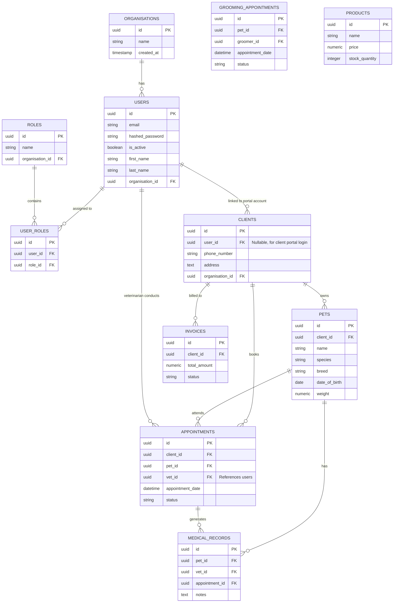

# Database Architecture & ERD

## Enterprise Schema Design

The EVHSS Enterprise Platform utilizes PostgreSQL as its primary datastore.
The schema is designed from Day 1 to support all future modules securely and efficiently.

### Shared Columns
Every major table includes:
- `id`: UUID (Primary Key)
- `created_at`: Timestamp with time zone
- `updated_at`: Timestamp with time zone
- `deleted_at`: Timestamp with time zone (Soft Delete)
- `created_by`: UUID (Foreign Key to users, optional)
- `updated_by`: UUID (Foreign Key to users, optional)
- `organisation_id`: UUID (Multi-tenant support)

## Entity Relationship Diagram (ERD)

## Security & Row Level Security (RLS)
As we are designing for potential Supabase usage, Row Level Security policies will be used to ensure that users (and external portal users) can only access data where `organisation_id` matches their own context, and `client_id` matches their portal user ID.
